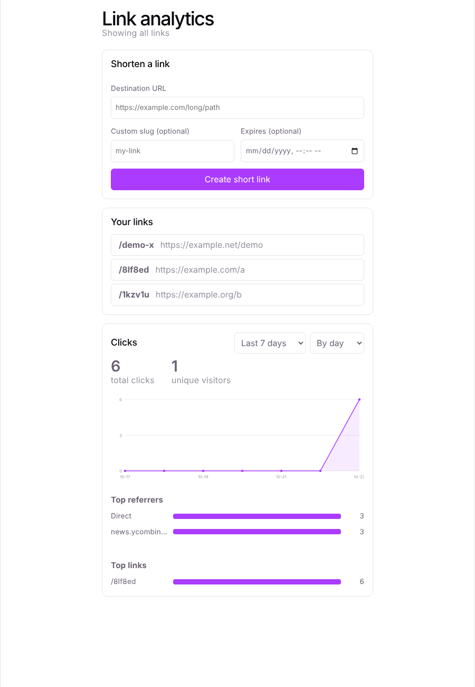
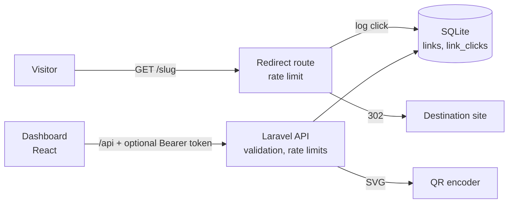

# URL Shortener + Analytics Dashboard

A link-shortening service with custom slugs, link expiry and QR codes, plus a React
dashboard that charts clicks over time and shows top referrers and top links.

**Status:** complete for its first release (90-day plan block 1, Oct 2026). CI runs tests, audits and a Docker smoke test on every push.



## Features

- Short links with a custom slug or a random one; reserved words and bad characters rejected
- `GET /{slug}` redirects (302) and logs a click; optional expiry returns `410 Gone`
- SVG QR code per link, generated in-app with no external service
- Analytics API and dashboard: total clicks, unique visitors, clicks over time (day/week, 7/30/90 days), top referrers, top links
- Safety: destination URL rules, per-IP rate limits, security headers, optional bearer-token auth for the management API
- Docker image, docker-compose and GitHub Actions CI

Not built: geography and device/browser breakdowns (see [docs/ROADMAP.md](docs/ROADMAP.md)), user accounts, and a hosted deployment.

## Tech Stack

- **Backend:** Laravel 13 (PHP 8.3), SQLite
- **Frontend:** React 19 (Vite), hand-written SVG charts
- **Tests:** PHPUnit (backend), Vitest + Testing Library (frontend)

## Architecture



A visit hits `/{slug}`, the app looks up the link, records a row in `link_clicks` (IP, user agent, referrer) and redirects. The dashboard only talks to the JSON API, which runs SQL aggregates over `link_clicks`.

## Project Structure

```
.
├── app/                # Models, controllers, middleware, SafeDestination/ValidSlug rules, QrCode service
├── database/           # Migrations and the local SQLite database
├── routes/             # web.php (redirect) and api.php (management API)
├── frontend/           # React (Vite) dashboard and its tests
├── docker/             # Container entrypoint
├── .github/workflows/  # CI
└── docs/               # ROADMAP, DEVLOG, DEMO script, TRACKER
```

## Setup

### Backend

```bash
composer install
cp .env.example .env
php artisan key:generate
touch database/database.sqlite
php artisan migrate
php artisan serve        # http://localhost:8000
php artisan test         # run the backend tests 
cd frontend && npm test  # run the frontend tests (vitest + Testing Library)
```

Requires PHP 8.3 with the `sqlite3`, `pdo_sqlite`, `mbstring`, `dom` and `xml`
extensions, and Composer.

Make sure `.env` has:

```
DB_CONNECTION=sqlite
```

### Frontend

The dashboard (create links, QR code, click charts) lives in `frontend/`; screenshot: `docs/dashboard.png`. Run the backend on port 8000 first.

```bash
cd frontend
npm install
npm run dev      # http://localhost:5173, proxies /api to Laravel on :8000
npm run build    # production build
npm run lint
```

### Quick smoke test

With the backend running:

```bash
curl -X POST localhost:8000/api/links -H 'Accept: application/json' \
  -H 'Content-Type: application/json' \
  -d '{"destination_url":"https://example.com","slug":"demo"}'
curl -i localhost:8000/demo               # 302 to the destination, click logged
curl localhost:8000/api/links/demo/analytics?days=7
```

Always send `Accept: application/json` so validation errors come back as JSON.

## Docker and CI (Day 8)

```bash
docker compose up --build        # dashboard: http://localhost:8000/dashboard/
# or: docker build -t url-shortener . && docker run -p 8000:8000 -v url-data:/data url-shortener
```

The multi-stage `Dockerfile` builds the React dashboard, installs PHP dependencies without dev packages, and runs as the unprivileged `www-data` user in production mode (`APP_DEBUG=false`). SQLite lives in the `/data` volume. Set `APP_KEY` (`docker run --rm <image> php artisan key:generate --show`) or a temporary key is generated on each start. The container uses PHP's built-in server, which is fine for a demo; put nginx + php-fpm or FrankenPHP in front for real traffic.

GitHub Actions (`.github/workflows/ci.yml`) runs on every push to `main` and every pull request: backend tests + `composer audit`, frontend lint/tests/build + `npm audit`, then builds the Docker image and smoke-tests it (`/up`, dashboard, create a link, redirect). `pint --test` runs as an advisory step.

## API

| Method | Endpoint            | Description                                  |
|--------|----------------------|-----------------------------------------------|
| GET    | `/api/links`         | List all links                                |
| POST   | `/api/links`         | Create a new short link                       |
| GET    | `/api/links/{slug}`  | Link details as JSON (does not log a click)   |
| GET    | `/{slug}`            | Short URL: 302 to the destination, click logged |
| GET    | `/api/links/{slug}/analytics` | Per-link totals, time series, top referrers |
| GET    | `/api/analytics`     | Same for all links, plus `top_links`          |
| GET    | `/api/links/{slug}/qr` | QR code (SVG) for the short URL             |

Slugs: 3-32 characters of letters, numbers, `-` and `_`; stored lowercase;
reserved words (`api`, `up`, `admin`, ...) are rejected.

Optional `expires_at` (a future date/time) on `POST /api/links`: after that moment
the short URL and QR endpoint return `410 Gone` and visits are not counted.
The QR code is generated in-app (`app/Services/QrCode.php`), no external service.

Analytics query params: `days` (1-365, default 30) and `interval` (`day` or
`week`). The series is zero-filled so charts have no gaps.

### Authentication

Set `API_TOKEN` in `.env` (or the container environment) and every management endpoint (create/list links, link details, analytics) requires `Authorization: Bearer <token>`; otherwise they return `401`. Redirects `/{slug}` and the QR image stay public. With no `API_TOKEN` the API is open, which is fine for a local demo only. The dashboard has an "API token" box that keeps the token in `sessionStorage` for the tab.

## Demo

A five-minute walkthrough is in [docs/DEMO.md](docs/DEMO.md).

## Roadmap

See [docs/ROADMAP.md](docs/ROADMAP.md) for the sprint-by-sprint build plan.

## Known limitations

- Auth is a single shared token, not user accounts; links are not owned by anyone.
- Rate limits use the cache store; in production use Redis (not `array`/`file`) and set `TRUSTED_PROXIES` behind a load balancer.
- The container uses PHP's built-in server and SQLite: fine for a demo or small deploy, not for heavy traffic.
- The full `App` page (filters + data loading) has no unit test; its parts do.
- No geography or device breakdown.

## Security (Day 7 pass)

- Destination URLs must be http(s), max 2048 chars, with no spaces/control characters, no `user:pass@`, not this app's own host, and not `localhost` or a private/reserved IP (`app/Rules/SafeDestination.php`).
- Rate limits per IP: 10 link creations/min, 120 API reads/min, 300 redirects/min (HTTP 429 + `Retry-After`).
- Every response carries `X-Content-Type-Options`, `X-Frame-Options`, `Referrer-Policy` and `Permissions-Policy`; the SVG QR response also gets a locked-down CSP.
- Keep `APP_DEBUG=false` in production. `.env` is git-ignored and no secrets are committed.
- `npm audit` and `composer audit` run in CI on every push.
- Optional `API_TOKEN` bearer auth on the management API (compared in constant time).
